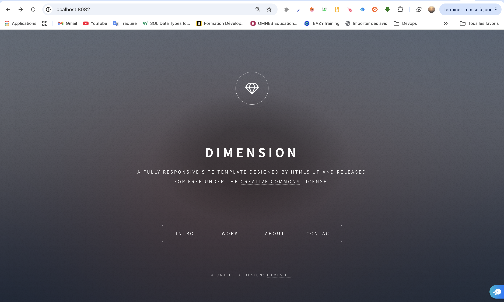

# Site statique conteneurisé avec Docker et nginx

Conteneurisation d'un site web statique (HTML, CSS, JavaScript) avec une image Docker légère basée sur **nginx**.

Premier exercice d'une série dont l'objectif est de savoir conteneuriser n'importe quelle application, en partant d'une page blanche.

## Stack

| Outil | Rôle |
|---|---|
| Docker | Conteneurisation |
| nginx (`stable-alpine`) | Serveur web qui sert les fichiers du site |
| HTML5 / CSS / JavaScript | Site statique (template *Dimension*) |

## Le Dockerfile

```dockerfile
FROM nginx:stable-alpine
COPY . /usr/share/nginx/html
EXPOSE 80
```

- **`nginx:stable-alpine`** : branche stable de nginx, sur Alpine Linux pour une image légère (~64 Mo)
- **`/usr/share/nginx/html`** : le dossier dans lequel nginx cherche les fichiers à servir (défini dans sa configuration par défaut)
- **Pas de `CMD`** : la commande de lancement `nginx -g "daemon off;"` est héritée de l'image de base

Un fichier `.dockerignore` exclut de l'image tout ce qui n'est pas utile au site (`.git`, `README.MD`, `LICENSE.MD`, `Dockerfile`, `.dockerignore`).

## Lancer le projet

```bash
# Construire l'image
docker build -t static-web:v2 .

# Lancer le conteneur (port 8082 sur la machine → port 80 dans le conteneur)
docker run -d --name web -p 8082:80 static-web:v2
```

Le site est accessible sur http://localhost:8082



## Tester

```bash
# La page d'accueil répond
curl -I http://localhost:8082
# → HTTP/1.1 200 OK

# Les fichiers exclus par le .dockerignore ne sont pas dans l'image
curl -I http://localhost:8082/README.MD
# → HTTP/1.1 404 Not Found
```
[Curl](screenshots/TestCurl.png)

## Nettoyer

```bash
docker rm -f web
docker rmi static-web:v2
```

## Ce que j'ai appris

- **Une méthode pour conteneuriser n'importe quelle application**, en répondant à 6 questions : langage et version, dépendances, fichiers à copier, compilation, port, commande de lancement
- **Pour un site statique, c'est au DevOps de choisir le serveur web** : les fichiers HTML ne disent pas comment les servir
- **Choisir un tag d'image** : version fixée plutôt que `latest`, variante légère (`alpine`), branche stable
- **`EXPOSE` décrit le port dans le conteneur**, la correspondance avec la machine se fait au lancement avec `-p machine:conteneur`
- **Vérifier plutôt que supposer** : le `.dockerignore` a été validé par un test (404 sur un fichier exclu)

## Crédits

Site basé sur le template [Dimension](https://html5up.net/dimension) de [HTML5 UP](https://html5up.net), sous licence [Creative Commons Attribution 3.0](https://html5up.net/license).
